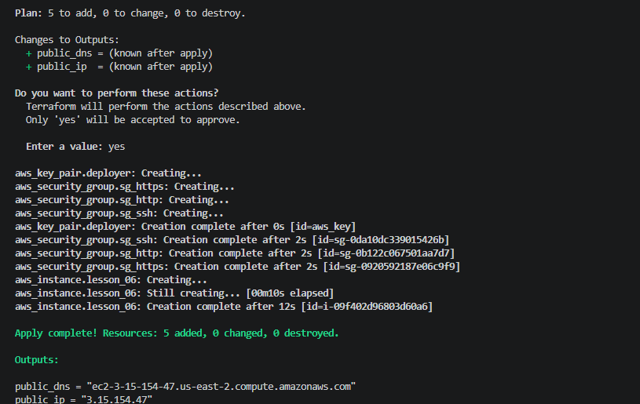
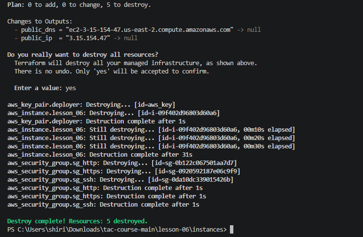
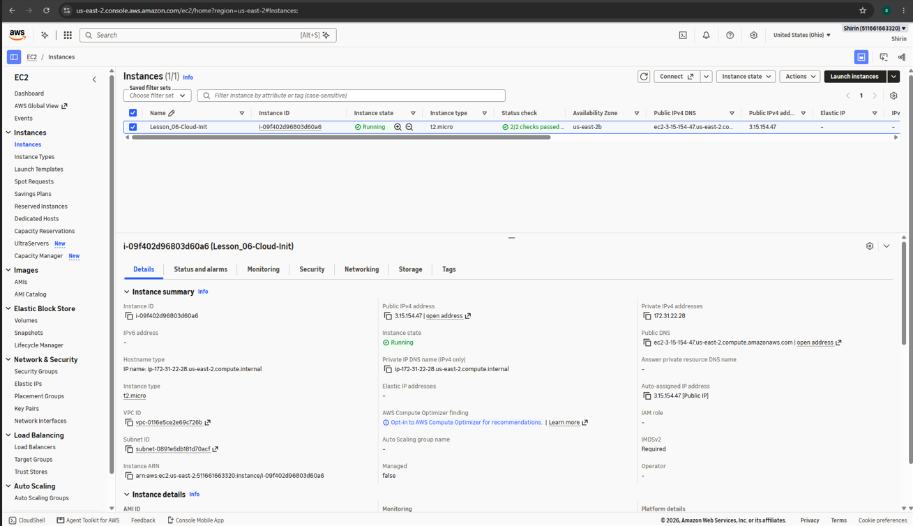
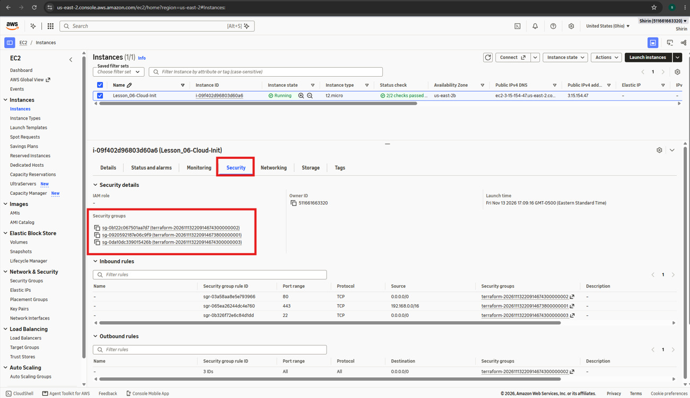
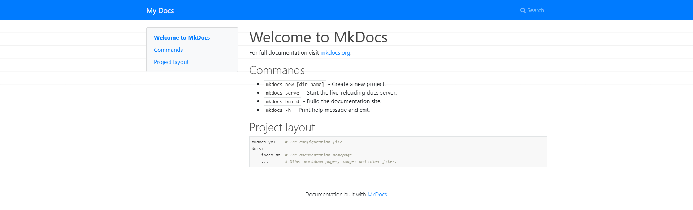

# Terraform AWS Learning Labs

A hands-on project exploring Infrastructure as Code (IaC) with Terraform and AWS, from provisioning cloud resources to automating server configuration.

## Project Overview

### AWS EC2 with Terraform and Cloud-Init

This project is part of my Terraform learning journey, where I put together the concepts covered throughout the course into one practical AWS deployment.

I used Terraform to create an EC2 instance, configure security groups, and set up SSH access. I also integrated cloud-init to automate the installation of Apache and MkDocs, creating a documentation website without having to configure everything manually after launching the server.

## Tools & Technologies

- **Terraform** – Infrastructure provisioning and lifecycle management
- **AWS EC2** – Ubuntu virtual server
- **AWS Security Groups** – Network access rules for SSH, HTTP, and HTTPS
- **SSH** – Key-based authentication
- **Cloud-init** – Automated server configuration
- **Apache & MkDocs** – Web server and documentation website
- **Windows PowerShell** – Running Terraform commands and managing local files

## What I Worked On

- Created an Ubuntu EC2 instance (`t2.micro`) using Terraform.
- Configured three AWS security groups for SSH (22), HTTP (80), and HTTPS (443).
- Generated an SSH key pair and registered the public key in AWS.
- Connected a cloud-init YAML script to the EC2 configuration using `user_data`.
- Automated Linux user creation, Apache installation, and MkDocs website deployment.
- Used Windows PowerShell to work with Terraform and manage project files.
- Explored Terraform state, reviewed infrastructure changes, and replaced an EC2 instance while troubleshooting the cloud-init setup.
- Cleaned up the AWS resources using `terraform destroy` after completing the lab.

## Terraform Commands I Practiced

| Command | What I Used It For |
|---|---|
| `terraform fmt` | Formatting Terraform files |
| `terraform init` | Initializing the project and installing the AWS provider |
| `terraform validate` | Checking the configuration for errors |
| `terraform plan` | Reviewing changes before applying them |
| `terraform apply` | Creating AWS resources |
| `terraform state list` | Viewing resources tracked by Terraform |
| `terraform show` | Inspecting Terraform state |
| `terraform apply -replace="aws_instance.lesson_06"` | Recreating the EC2 instance during troubleshooting |
| `terraform plan -destroy` | Reviewing which resources would be removed |
| `terraform destroy` | Removing AWS resources after completing the lab |

## Deployment Screenshots

Here are a few screenshots from my lab showing the Terraform deployment, AWS resources, and the final website.

### 1. Terraform Apply

Successfully created five AWS resources using Terraform through Windows PowerShell.



### 2. Terraform Destroy

Removed the resources after finishing the lab.



### 3. EC2 Instance

The Ubuntu EC2 instance running in AWS, with successful status checks.



### 4. Security Groups

The three security groups created through Terraform, with inbound rules for SSH, HTTP, and HTTPS.



### 5. MkDocs Website

The MkDocs documentation website served through Apache after the cloud-init setup.



## Project Structure

```text
terraform-aws-learning-labs/
├── .gitignore
├── README.md
└── ec2-cloud-init/
    ├── instances/
    │   ├── main.tf
    │   ├── outputs.tf
    │   ├── provider.tf
    │   └── version.tf
    ├── screenshots/
    │   ├── 01-terraform-apply.png
    │   ├── 02-terraform-destroy.png
    │   ├── 03-ec2-instance.png
    │   ├── 04-security-groups.png
    │   └── 05-mkdocs-website.png
    └── scripts/
        └── apache-mkdocs.yaml
```

## What I Learned & What I'd Improve

This lab helped me better understand how Terraform manages AWS resources, how its state tracks infrastructure, and how cloud-init can automate server configuration.

One of the most useful parts was troubleshooting the EC2 deployment. I had to review my Terraform configuration, understand why the cloud-init setup hadn't worked as expected, and replace the instance to apply the corrected configuration.

There are also a few things I'd approach differently in a real-world environment:

- Restrict SSH access to trusted IP addresses instead of allowing `0.0.0.0/0`.
- Use Terraform variables to make configurations easier to reuse.
- Review Linux administrative permissions to follow least-privilege practices.
- Apply stronger security controls for production infrastructure.

## Notes

This project follows the original course exercises and was built as a learning lab, not a production deployment.

Personal SSH public keys have been replaced with placeholders in the shared code. Anyone reusing the configuration will need to provide their own valid keys.

All AWS resources created during this lab were removed using Terraform after testing.

